# Habit Tracker — Modelo ER

Reflete o banco depois de todas as migrations em `database/migrations`. As tabelas do framework (`migrations`, `cache`, `jobs`, `sessions`, `password_reset_tokens`, `personal_access_tokens` etc.) ficam de fora. As colunas que o escopo prevê, mas que ainda não existem no banco, estão em [Colunas planejadas](#colunas-planejadas).

```mermaid
erDiagram
    users {
        bigint id PK "increment"
        varchar(255) name "NOT NULL"
        varchar(255) email UK "NOT NULL"
        timestamp email_verified_at
        varchar(255) password "NOT NULL"
        varchar(100) remember_token
        int xp_vitalicio "NOT NULL · default 0"
        timestamp ultimo_acesso
        int streak_atual "NOT NULL · default 0"
        bigint fk_id_dragao FK "→ dragao (dragão ativo) · on delete set null"
        timestamp created_at
        timestamp updated_at
    }
    categoria {
        bigint id PK "increment"
        varchar(40) nome UK "NOT NULL"
    }
    objetivo_usuario {
        bigint fk_id_usuario PK, FK "→ users · on delete cascade"
        bigint fk_id_categoria PK, FK "→ categoria · on delete cascade"
    }
    habito_modelo {
        bigint id PK "increment"
        bigint fk_id_categoria FK "NOT NULL · → categoria"
        varchar(80) nome "NOT NULL"
        tipo_meta tipo_meta "NOT NULL"
        decimal meta_padrao "(10,2) · NOT NULL"
        varchar(20) unidade_padrao "NOT NULL"
        dificuldade dificuldade_padrao "NOT NULL"
        boolean prioridade_mvp "NOT NULL"
    }
    habito {
        bigint id PK "increment"
        bigint fk_id_usuario FK "NOT NULL · → users · on delete cascade"
        bigint fk_id_categoria FK "NOT NULL · → categoria"
        varchar(80) nome "NOT NULL"
        polaridade polaridade "NOT NULL · default BOM"
        tipo_meta tipo_meta "NOT NULL · default REALIZACAO"
        frequencia frequencia "NOT NULL · default DIARIA"
        varchar(3) dia_frequencia "SEG…DOM ou 1…31; null no diário"
        decimal valor_meta "(10,2)"
        varchar(20) unidade
        dificuldade dificuldade "NOT NULL · gerada pelo peso"
        int peso "NOT NULL · 1 a 20 · default 5"
        boolean ativo "NOT NULL · default true"
        timestamp inactivated_at "quando foi desativado"
        time horario_lembrete
        timestamp created_at "NOT NULL · default now"
    }
    registro_habito {
        bigint id PK "increment"
        bigint fk_id_habito FK "NOT NULL · → habito · on delete cascade"
        date data "NOT NULL"
        status_registro status "NOT NULL · default CONCLUIDO"
        decimal valor_realizado "(10,2)"
        decimal percentual "(5,2) · NOT NULL · default 100"
    }
    dragao {
        bigint id PK "increment"
        bigint fk_id_usuario FK "NOT NULL · → users · on delete cascade"
        elemento_dragao elemento "elemento atual · obrigatório a partir de 6.000 XP"
        varchar(40) nome "NOT NULL"
        int xp_ciclo "NOT NULL"
        estagio_dragao estagio "NOT NULL · default OVO · gerado pelo xp_ciclo"
        status_dragao status "NOT NULL"
        date data_nascimento "NOT NULL"
        date data_termino
        varchar(255) arte_final_url
        int tempo_total_dias
    }
    escolha_elemento {
        bigint id PK "increment"
        bigint fk_id_dragao FK "NOT NULL · → dragao · on delete cascade"
        elemento_dragao elemento "NOT NULL"
        estagio_dragao estagio "NOT NULL · estágio do dragão na escolha"
        timestamp data_escolha "NOT NULL"
    }
    xp_diario {
        bigint id PK "increment"
        bigint fk_id_usuario FK "NOT NULL · → users · on delete cascade"
        bigint fk_id_dragao FK "NOT NULL · → dragao · on delete cascade"
        date data "NOT NULL"
        decimal percentual_ponderado "(5,2) · NOT NULL"
        int xp_ganho "NOT NULL"
    }
    insignia {
        bigint id PK "increment"
        varchar(60) nome "NOT NULL"
        varchar(255) descricao "NOT NULL"
        varchar(255) icone_url "NOT NULL"
    }
    usuario_insignia {
        bigint fk_id_usuario PK, FK "→ users · on delete cascade"
        bigint fk_id_insignia PK, FK "→ insignia · on delete cascade"
        timestamp data_conquista "NOT NULL"
    }
    gatilho_notificacao {
        bigint id PK "increment"
        varchar(40) tipo "NOT NULL"
        canal_notificacao canal "NOT NULL"
        varchar(40) frequencia "NOT NULL · texto livre"
        varchar(255) texto_base "NOT NULL"
    }
    config_notificacao {
        bigint fk_id_usuario PK, FK "→ users · on delete cascade"
        bigint fk_id_gatilho PK, FK "→ gatilho_notificacao · on delete cascade"
        boolean ativo "NOT NULL"
        time horario
    }

    users ||--o{ objetivo_usuario : "fk_id_usuario"
    categoria ||--o{ objetivo_usuario : "fk_id_categoria"
    categoria ||--o{ habito_modelo : "fk_id_categoria"
    users ||--o{ habito : "fk_id_usuario"
    categoria ||--o{ habito : "fk_id_categoria"
    habito ||--o{ registro_habito : "fk_id_habito"
    users ||--o{ dragao : "fk_id_usuario"
    dragao |o--o| users : "fk_id_dragao (ativo)"
    dragao ||--o{ escolha_elemento : "fk_id_dragao"
    users ||--o{ xp_diario : "fk_id_usuario"
    dragao ||--o{ xp_diario : "fk_id_dragao"
    users ||--o{ usuario_insignia : "fk_id_usuario"
    insignia ||--o{ usuario_insignia : "fk_id_insignia"
    users ||--o{ config_notificacao : "fk_id_usuario"
    gatilho_notificacao ||--o{ config_notificacao : "fk_id_gatilho"
```

## Enums

Os enums são guardados como texto (`varchar`) e validados pelos enums de `app/Enums`.

| Enum | Valores | Classe |
|---|---|---|
| `tipo_meta` | `REALIZACAO`, `TEMPO`, `QUANTIDADE` | `TipoMeta` |
| `dificuldade` | `FACIL` (peso 1–5), `MEDIO` (6–10), `DIFICIL` (11–15), `MUITO_DIFICIL` (16–20) | `Dificuldade` |
| `polaridade` | `BOM`, `RUIM` | `Polaridade` |
| `frequencia` | `DIARIA`, `SEMANAL`, `MENSAL` | `Frequencia` |
| `dia_semana` | `SEG`, `TER`, `QUA`, `QUI`, `SEX`, `SAB`, `DOM` | `DiaSemana` |
| `status_registro` | `CONCLUIDO`, `EM_ANDAMENTO`, `NAO_CONCLUIDO` | `StatusRegistro` |
| `status_dragao` | `ATIVO`, `SANTUARIO` | `StatusDragao` |
| `elemento_dragao` | `FOGO`, `TERRA`, `AGUA`, `AR` | `ElementoDragao` |
| `estagio_dragao` | `OVO` (0 XP), `FILHOTE` (120), `JOVEM` (1.000), `ADULTO` (3.500), `ADULTO_FINAL` (9.000) | `EstagioDragao` |
| `canal_notificacao` | `PUSH`, `IN_APP` | `CanalNotificacao` |

## Índices

| Tabela | Índice | Uso |
|---|---|---|
| `users` | único em `email` | login |
| `categoria` | único em `nome` | |
| `registro_habito` | `registro_habito_habito_data_index` em (`fk_id_habito`, `data`) | busca do check-in de um hábito num dia |

## Regras do modelo

- **Usuário:** o `usuario` do escopo é a tabela `users` do Laravel (`name`, `email`, `password`). O `xp_vitalicio` só é alterado pelas regras do MOD5, e o nível (1 a 30) não tem tabela nem coluna: é calculado pelo `NivelService` a partir do `xp_vitalicio`, com os intervalos de `config/progression.php` (nível 1 em 0 XP, passos ~10% maiores, nível 30 em 9.000 XP).
- **Hábito:**
  - O `dia_frequencia` depende da `frequencia`: `null` no `DIARIA`, um `dia_semana` no `SEMANAL` e um dia do mês de `1` a `31` no `MENSAL`. Um hábito mensal num dia que o mês não tem (ex.: 31 em abril) não aparece naquele mês. A API exige os dois campos juntos.
  - A `dificuldade` é gerada pelo `peso` (1 a 20).
  - O `created_at` vem só do banco.
  - Excluir um hábito só o desativa (`ativo = false` e `inactivated_at`), mantendo os check-ins.
- **Check-in (`registro_habito`):** um registro por hábito e dia, buscado pelo índice (`fk_id_habito`, `data`). O status e o percentual dependem do `tipo_meta` do hábito: em `TEMPO` e `QUANTIDADE` são calculados comparando `valor_realizado` com o `valor_meta`.
- **XP diário (`xp_diario`):** histórico do XP de cada dia, um registro por usuário e dia, com o dragão do ciclo. É gravado pelo sistema, não pelo usuário: o registro do dia é recalculado a cada check-in e, no caso de hoje, também quando um hábito é criado ou desativado.
- **Dragão:**
  - Um usuário pode ter vários dragões (os do Santuário, com `status = SANTUARIO`), mas só um `ATIVO`, apontado por `users.fk_id_dragao`.
  - O `estagio` é gerado pelo `xp_ciclo` e atualizado sempre que ele muda; o marco de 6.000 XP (escolha do elemento) não é um estágio.
  - O `elemento` é o elemento atual (enum `elemento_dragao`) e passa a ser obrigatório a partir dos 6.000 XP do ciclo. Cada troca gera um registro em `escolha_elemento`, que é a trajetória. O cenário de fundo e a aparência da forma final de cada elemento ficam com o front-end.
  - Não há tabelas de ovo, de estágio nem de elemento.

## Colunas planejadas

Previstas pelo escopo e pelo DER original, mas ainda sem migration. Entram no banco com os módulos indicados.

| Tabela | Coluna | Tipo | Módulo |
|---|---|---|---|
| `users` | `maior_streak` | int | MOD7 |
| `users` | `onboarding_concluido` | boolean | MOD8 (onboarding) |
| `habito` | `fk_id_modelo` | bigint → `habito_modelo` | MOD2 (hábito criado da biblioteca) |
| `habito` | `inicio_abstinencia` | timestamp | MOD3-TASK4 / MOD7-TASK9 (hábitos ruins) |
