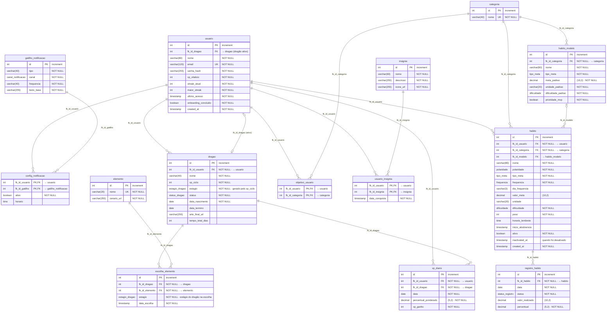

# Habit Tracker — Modelo ER

## Enums

| Enum | Valores |
|---|---|
| `tipo_meta` | `REALIZACAO`, `TEMPO`, `QUANTIDADE` |
| `dificuldade` | `FACIL`, `MEDIO`, `DIFICIL`, `MUITO_DIFICIL` |
| `polaridade` | `BOM`, `RUIM` |
| `frequencia` | `DIARIA`, `SEMANAL`, `MENSAL` |
| `status_registro` | `CONCLUIDO`, `EM_ANDAMENTO`, `NAO_CONCLUIDO` |
| `status_dragao` | `ATIVO`, `SANTUARIO` |
| `estagio_dragao` | `OVO` (0 XP), `FILHOTE` (120), `JOVEM` (1.000), `ADULTO` (3.500), `ADULTO_FINAL` (9.000) |
| `canal_notificacao` | `PUSH`, `IN_APP` |
| `dia_semana` | `SEG`, `TER`, `QUA`, `QUI`, `SEX`, `SAB`, `DOM` |

O estágio de crescimento do dragão é o enum `estagio_dragao` (ESCOPO §4.2), guardado em `dragao.estagio` e atualizado sempre que o `xp_ciclo` muda; o marco de 6.000 XP (escolha do elemento) não é um estágio. Não há tabelas de estágio nem de ovo: o dragão não registra de que ovo nasceu.

Um usuário pode ter vários dragões (os do Santuário, com status `SANTUARIO`), mas só um `ATIVO`, apontado por `usuario.fk_id_dragao` (null quando não há dragão ativo).

A tabela `registro_habito` tem um índice composto em (`fk_id_habito`, `data`): o check-in de um hábito num dia é buscado por esse par, e o POST da API marca (cria ou atualiza) ou desmarca (exclui) esse registro.

A tabela `xp_diario` é o histórico do XP de cada dia (um registro por usuário e dia, com o dragão do ciclo). Ela é gravada pelo sistema, não pelo usuário: o registro do dia é recalculado a cada check-in marcado ou desmarcado e, no caso de hoje, também quando um hábito é criado ou desativado. A API só a lista.

O nível do usuário (1 a 30) não tem tabela nem coluna: é calculado pelo `NivelService` a partir do `usuario.xp_vitalicio`, com os intervalos gerados por `config/progression.php` (nível 1 em 0 XP, passos ~10% maiores e nível 30 em 9.000 XP).

O `habito.dia_frequencia` depende da `frequencia`: é `null` no `DIARIA`, um `dia_semana` no `SEMANAL` e um dia do mês de `1` a `31` no `MENSAL`. Um hábito mensal num dia que o mês não tem (ex.: 31 em abril) não aparece naquele mês. A API exige os dois campos juntos: quem envia a `frequencia` envia também o `dia_frequencia`, e vice-versa.
