# Habit Tracker — Modelo ER

Modelo lógico (PostgreSQL) do Habit Tracker, convertido de [[Habit Tracker - Modelo ER.canvas]].

```mermaid
erDiagram
    insignia {
        int id PK "increment"
        varchar(60) nome "NOT NULL"
        varchar(255) descricao "NOT NULL"
        varchar(255) icone_url "NOT NULL"
    }
    usuario {
        int id PK "increment"
        int fk_id_nivel FK "NOT NULL · → nivel"
        varchar(80) nome "NOT NULL"
        varchar(120) email UK "NOT NULL"
        varchar(255) senha_hash "NOT NULL"
        int xp_vitalicio "NOT NULL"
        int streak_atual "NOT NULL"
        int maior_streak "NOT NULL"
        timestamp ultimo_acesso "NOT NULL"
        boolean onboarding_concluido "NOT NULL"
        timestamp data_cadastro "NOT NULL"
    }
    config_notificacao {
        int fk_id_usuario PK, FK "→ usuario"
        int fk_id_gatilho PK, FK "→ gatilho_notificacao"
        boolean ativo "NOT NULL"
        time horario
    }
    gatilho_notificacao {
        int id PK "increment"
        varchar(40) tipo "NOT NULL"
        canal_notificacao canal "NOT NULL"
        varchar(40) frequencia "NOT NULL"
        varchar(255) texto_base "NOT NULL"
    }
    dragao {
        int id PK "increment"
        int fk_id_usuario FK "NOT NULL · → usuario"
        int fk_id_ovo FK "NOT NULL · → ovo"
        int fk_id_estagio FK "NOT NULL · → estagio"
        varchar(40) nome "NOT NULL"
        int xp_ciclo "NOT NULL"
        status_dragao status "NOT NULL"
        date data_nascimento "NOT NULL"
        date data_termino
        varchar(255) arte_final_url
        int tempo_total_dias
    }
    escolha_elemento {
        int id PK "increment"
        int fk_id_dragao FK "NOT NULL · → dragao"
        int fk_id_elemento FK "NOT NULL · → elemento"
        int fk_id_estagio FK "NOT NULL · → estagio"
        timestamp data_escolha "NOT NULL"
    }
    xp_diario {
        int id PK "increment"
        int fk_id_usuario FK "NOT NULL · → usuario"
        int fk_id_dragao FK "NOT NULL · → dragao"
        date data "NOT NULL"
        decimal percentual_ponderado "(5,2) · NOT NULL"
        int xp_ganho "NOT NULL"
    }
    estagio {
        int id PK "increment"
        varchar(30) nome "NOT NULL"
        int ordem "NOT NULL"
        int xp_marco "NOT NULL"
    }
    elemento {
        int id PK "increment"
        varchar(20) nome UK "NOT NULL"
        varchar(255) cenario_url "NOT NULL"
    }
    ovo {
        int id PK "increment"
        varchar(40) nome "NOT NULL"
        varchar(255) imagem_url "NOT NULL"
    }
    nivel {
        int id PK "increment"
        int xp_necessario "NOT NULL"
        int xp_acumulado "NOT NULL"
    }
    habito_modelo {
        int id PK "increment"
        int fk_id_categoria FK "NOT NULL · → categoria"
        varchar(80) nome "NOT NULL"
        tipo_meta tipo_meta "NOT NULL"
        decimal meta_padrao "(10,2) · NOT NULL"
        varchar(20) unidade_padrao "NOT NULL"
        dificuldade dificuldade_padrao "NOT NULL"
        boolean prioridade_mvp "NOT NULL"
    }
    categoria {
        int id PK "increment"
        varchar(40) nome UK "NOT NULL"
    }
    objetivo_usuario {
        int fk_id_usuario PK, FK "→ usuario"
        int fk_id_categoria PK, FK "→ categoria"
    }
    registro_habito {
        int id PK "increment"
        int fk_id_habito FK "NOT NULL · → habito"
        date data "NOT NULL"
        status_registro status "NOT NULL"
        decimal valor_realizado "(10,2)"
        decimal percentual "(5,2) · NOT NULL"
    }
    usuario_insignia {
        int fk_id_usuario PK, FK "→ usuario"
        int fk_id_insignia PK, FK "→ insignia"
        timestamp data_conquista "NOT NULL"
    }
    habito {
        int id PK "increment"
        int fk_id_usuario FK "NOT NULL · → usuario"
        int fk_id_categoria FK "NOT NULL · → categoria"
        int fk_id_modelo FK "→ habito_modelo"
        varchar(80) nome "NOT NULL"
        polaridade polaridade "NOT NULL"
        tipo_meta tipo_meta "NOT NULL"
        frequencia frequencia "NOT NULL"
        decimal valor_meta "(10,2)"
        varchar(20) unidade
        dificuldade dificuldade "NOT NULL"
        int peso "NOT NULL"
        time horario_lembrete
        timestamp inicio_abstinencia
        boolean ativo "NOT NULL"
        timestamp data_criacao "NOT NULL"
    }

    nivel ||--o{ usuario : "fk_id_nivel"
    usuario ||--o{ objetivo_usuario : "fk_id_usuario"
    categoria ||--o{ objetivo_usuario : "fk_id_categoria"
    categoria ||--o{ habito_modelo : "fk_id_categoria"
    usuario ||--o{ habito : "fk_id_usuario"
    categoria ||--o{ habito : "fk_id_categoria"
    habito_modelo |o--o{ habito : "fk_id_modelo"
    habito ||--o{ registro_habito : "fk_id_habito"
    usuario ||--o{ xp_diario : "fk_id_usuario"
    dragao ||--o{ xp_diario : "fk_id_dragao"
    usuario ||--o{ dragao : "fk_id_usuario"
    ovo ||--o{ dragao : "fk_id_ovo"
    estagio ||--o{ dragao : "fk_id_estagio"
    dragao ||--o{ escolha_elemento : "fk_id_dragao"
    elemento ||--o{ escolha_elemento : "fk_id_elemento"
    estagio ||--o{ escolha_elemento : "fk_id_estagio"
    usuario ||--o{ usuario_insignia : "fk_id_usuario"
    insignia ||--o{ usuario_insignia : "fk_id_insignia"
    usuario ||--o{ config_notificacao : "fk_id_usuario"
    gatilho_notificacao ||--o{ config_notificacao : "fk_id_gatilho"
```

**Convenções:** PK das entidades = `id` (int, increment) · FKs = `fk_id_<tabela>` · tabelas associativas (`objetivo_usuario`, `usuario_insignia`, `config_notificacao`) têm PK composta pelas FKs.

## Enums

| Enum | Valores |
|---|---|
| `tipo_meta` | `REALIZACAO`, `TEMPO`, `QUANTIDADE` |
| `dificuldade` | `FACIL`, `MEDIO`, `DIFICIL`, `MUITO_DIFICIL` |
| `polaridade` | `BOM`, `RUIM` |
| `frequencia` | `DIARIA`, `SEMANAL`, `MENSAL` |
| `status_registro` | `CONCLUIDO`, `EM_ANDAMENTO`, `NAO_CONCLUIDO` |
| `status_dragao` | `ATIVO`, `SANTUARIO` |
| `canal_notificacao` | `PUSH`, `IN_APP` |
